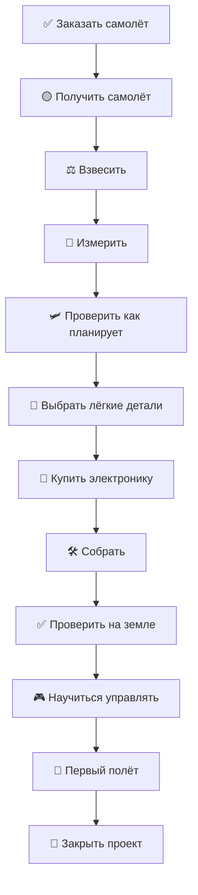

# 👋 Привет! Это наш проект самолёта

Мы вместе делаем маленький самолёт, который потом сможет слушаться пульта.

Но наша задача ещё больше:

- ✈️ сделать самолёт;
- 🎮 научиться им управлять;
- 🧠 научиться делать большие дела по маленьким шагам;
- ✅ довести проект до конца.

---

# 🟡 Где мы сейчас?

## Сейчас мы на шаге №1

**Ждём наш настоящий самолёт 35 см и готовимся его исследовать.**

Самолёт уже заказан ✅.

Пока он едет, мы:

- готовим весы и линейки;
- учимся узнавать части самолёта;
- смотрим картинки деталей;
- готовим место для проекта.

---

# ✅ Что уже сделали

- [x] решили сделать радиоуправляемый самолёт;
- [x] создали отдельный проект;
- [x] выбрали и заказали самолёт 35 см;
- [x] решили не покупать тяжёлую электронику наугад;
- [x] сделали список того, что можно купить сейчас;
- [x] сделали картинки и простые схемы;
- [x] договорились доводить каждую задачу до слова **ГОТОВО**.

---

# ⬜ Что осталось

---

# 👦 Как пользоваться этим репозиторием

## 1. Сначала всегда открывай эту страницу

Здесь написано, **где мы сейчас**.

## 2. Если хочешь посмотреть картинки

➡️ [`08_Картинки_для_понимания`](08_Картинки_для_понимания/)

Там можно посмотреть:

- части самолёта;
- мотор;
- сервопривод;
- аккумулятор;
- пульт;
- кто с кем соединяется.

## 3. Если хотим узнать, что купить

➡️ [`02_Наши_детали/03_ПОКУПАЕМ_СЕЙЧАС.md`](02_Наши_детали/03_ПОКУПАЕМ_СЕЙЧАС.md)

➡️ [`02_Наши_детали/04_ПОКУПАЕМ_ПОСЛЕ_ИЗМЕРЕНИЙ.md`](02_Наши_детали/04_ПОКУПАЕМ_ПОСЛЕ_ИЗМЕРЕНИЙ.md)

## 4. Если хотим узнать, что делает деталь

➡️ [`03_Как_это_работает`](03_Как_это_работает/)

## 5. Когда начнём собирать

➡️ [`04_Собираем_по_шагам`](04_Собираем_по_шагам/)

## 6. Перед полётом

➡️ [`05_Проверяем_перед_полетом`](05_Проверяем_перед_полетом/)

## 7. После полёта

➡️ [`06_Наши_полеты`](06_Наши_полеты/)

---

# 🎯 Наше правило одного шага

Мы не пытаемся сделать всё сразу.

Каждый раз спрашиваем:

> **Какое одно дело мы делаем сейчас?**

Когда оно закончено — ставим ✅ и только потом берём следующее.

---

# 🧩 Маленькая задача сейчас

Пока самолёт едет:

1. открой [`08_Картинки_для_понимания/01_САМОЛЕТ_И_ЕГО_ЧАСТИ.md`](08_Картинки_для_понимания/01_САМОЛЕТ_И_ЕГО_ЧАСТИ.md);
2. научись находить нос, крыло и хвост;
3. открой [`08_Картинки_для_понимания/02_ЭЛЕКТРОНИКА_В_КАРТИНКАХ.md`](08_Картинки_для_понимания/02_ЭЛЕКТРОНИКА_В_КАРТИНКАХ.md);
4. попробуй объяснить, что делают мотор, серва, батарейка и пульт.

Получилось? Значит сегодняшний маленький этап **ГОТОВ ✅**.

---

# ⚠️ Правило безопасности

То, что:

- режет 🔪;
- горячее 🔥;
- паяет;
- связано с зарядкой аккумулятора 🔋;
- крутит винт очень быстро 🌀

делает только взрослый.

Ребёнок помогает думать, выбирать, измерять, считать, отмечать и проверять.
