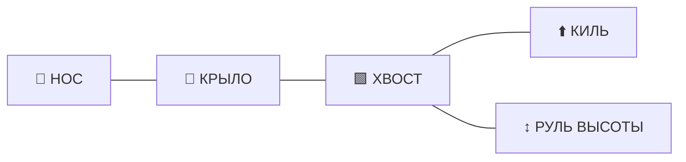

# ✈️ Самолёт и его части

## 👦 Самое главное

У самолёта есть несколько больших частей.



## 👃 Нос

Нос — перед самолёта.

Позже рядом с ним может появиться мотор.

## 🪽 Крыло

Крыло помогает самолёту держаться в воздухе.

```text
            НОС
             ↑
      ┌─────────────┐
◀─────┤    КРЫЛО    ├─────▶
      └─────────────┘
             │
             │ корпус
             │
           ХВОСТ
```

## 🟩 Хвост

Хвост помогает самолёту лететь устойчиво.

## ↕️ Руль высоты

Руль высоты помогает поднимать и опускать нос самолёта.

```text
руль вверх   → нос хочет подняться
руль вниз    → нос хочет опуститься
```

## ⬆️ Киль

Киль — вертикальная часть хвоста.

Он помогает самолёту не разворачиваться боком сам по себе.

---

# 📸 Когда наш самолёт придёт

Мы заменим учебные схемы **фотографиями именно нашего самолёта**.

Нужно сделать фотографии:

- [ ] сверху;
- [ ] снизу;
- [ ] слева;
- [ ] справа;
- [ ] спереди;
- [ ] сзади;
- [ ] крупно нос;
- [ ] крупно крыло;
- [ ] крупно хвост.

Потом на копиях фотографий добавим стрелки и подписи.

## Наша задача ребёнку

Когда самолёт придёт, ребёнок должен сам показать:

1. где нос;
2. где крыло;
3. где хвост;
4. где верх;
5. где низ.

Если получилось — карточка «Я знаю части самолёта» переходит в **ГОТОВО**.
