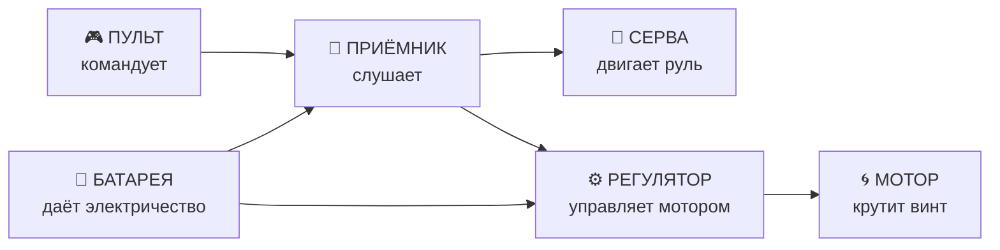

# 🔌 Электроника в картинках

Ниже не окончательные детали нашего самолёта. Это картинки, чтобы понять **кто что делает**.

# Вся команда самолёта



---

# 🎮 Пульт

Пульт — это то, что держит пилот.

Он говорит самолёту:

```text
⬆️ поднимайся
⬇️ снижайся
⬅️ поворачивай
➡️ поворачивай
🚀 быстрее / медленнее
```

📷 Официальные фотографии FlySky FS-i6X:
https://www.flysky-cn.com/fsi6x

Важно: это **кандидат на наш пульт**, а не деталь, которая уже установлена.

---

# 📡 Приёмник

Приёмник — маленькая плата в самолёте.

```text
ПУЛЬТ  ~ ~ ~ радиосигнал ~ ~ ~>  ПРИЁМНИК
```

👦 Можно представить, что пульт **говорит**, а приёмник — **слушает**.

Для нашего маленького самолёта приёмник должен быть очень лёгким.

---

# 💪 Серва

Серва — маленькая машинка, которая двигает руль.


📷 Пример очень маленькой сервы 1,7 г:
https://agfrc.com/index.php?id=2427

У справочного AGFRC C017CLS:

- масса 1,7 г;
- питание 3,6–4,2 В;
- размеры около 13,5 × 6,2 × 16 мм.

Это помогает понять, **насколько маленькими должны быть детали** в самолёте 35 см.

---

# 🌀 Мотор

Мотор крутит винт.

```text
[ БАТАРЕЯ ] → [ МОТОР ] → 🌀 → воздух назад
                                  ✈ самолёт вперёд
```

📷 Пример мотора класса 8520:
https://flymod.net/ru/item/racerstar_8520_brush_motor

Справочный мотор этого класса:

- диаметр около 8,5 мм;
- длина около 20 мм;
- масса около 5 г.

Он пока только **кандидат для проверки**.

---

# 🌀 Винт

Винт — маленькое вращающееся крыло.

```text
          \   |   /
           \  |  /
            \ | /
        ----- O -----
            / | \
           /  |  \
          /   |   \
```

⚠️ Работающий винт трогать нельзя.

Мотор с установленным винтом запускает только взрослый.

---

# 🔋 Аккумулятор

Аккумулятор хранит электричество.

Пример фотографии LiPo для RC-моделей из Wikimedia Commons:


Источник и лицензия:
https://commons.wikimedia.org/wiki/File:Lithium_polymer_battery_(11.1_volts).jpg

⚠️ На фотографии аккумулятор больше и другого напряжения, чем вероятная батарея нашего микросамолёта. Картинка показывает только **как выглядит LiPo**.

Наш будущий аккумулятор, вероятно, будет намного меньше и будет иметь 1S, но точный вариант выберем после взвешивания самолёта.

---

# 🧠 Мини-игра

Покажи пальцем или назови:

- что **даёт электричество**? → 🔋
- что **крутит винт**? → 🌀 мотор
- что **двигает руль**? → 💪 серва
- что **слушает пульт**? → 📡 приёмник
- чем **управляет пилот**? → 🎮 пультом

Если ребёнок смог ответить — этот урок закончен ✅.
